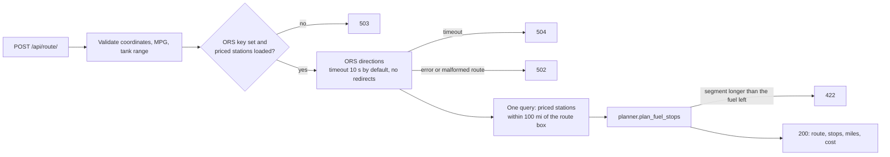

# Fuel route planner

What would a drive cost in fuel, and where should you stop? This Django REST API takes a start point, an end point, a vehicle's MPG and its tank range. It asks [OpenRouteService](https://openrouteservice.org/) (ORS) for the driving route, walks the route against a PostgreSQL table of station prices, and returns the route, a set of fuel stops and an estimated fuel bill.

It is an exploratory heuristic, not a navigation service. It does not find the globally cheapest plan, and you should not rely on it to avoid running out of fuel.

## How a request is handled



The planner (`map_API/api/planner.py`) works like this:

1. It measures each segment of the decoded polyline as a straight line, then scales the lengths so they add up to the driving distance ORS reports.
2. It starts with a full tank and drives segment by segment. If any single segment is longer than the fuel left, the route is rejected with 422 instead of returning a plan that looks feasible but isn't.
3. When the range left drops under a 50-mile buffer and the destination is still out of reach, it picks the cheapest station within 50 miles of that route point, or within 100 miles if none is closer. It charges the miles driven since the last fill at that station's price, then refills the tank.
4. Fuel burned after the last stop is charged at the last stop's price. On a trip with no stops it is charged at the cheapest positive price in the table.

Design choices worth knowing:

- **One station query per request.** Stations near the whole route are loaded once and filtered in memory with the haversine formula. An earlier version ran up to two queries per route point once the range ran low.
- **Antimeridian-safe.** If the search box would wrap ±180°, the query filters on latitude only, so stations across the date line are still found.
- **Rate-limited.** Each request spends one call from your ORS quota, so `/api/route/` has a per-client throttle (`ROUTE_RATE_LIMIT`, default `30/minute`). Over the limit it returns 429.
- **Provider errors stay generic.** Upstream failures map to fixed 502/504 messages, and no ORS response text is echoed back.

Known limits: the planner does not route the detour to a station, check road access or opening hours, or choose a fuel grade. A stop can be a station up to 100 miles off the route, ahead of or behind the point where the range ran low. Prices are stored as floats, so treat the total as a rough estimate rather than a receipt.

## Run it with Docker Compose

You need Docker and your own ORS API key ([free sign-up](https://openrouteservice.org/dev/#/signup)).

```sh
cd map_API
cp .env.example .env        # set ORS_API_KEY and choose your own DB_PASSWORD
docker compose up --build
```

Compose starts `postgres:17-alpine`. The API container then applies migrations, loads `fuel_prices_sample.csv` and serves on <http://127.0.0.1:8000>. Stop it with `docker compose down`, or use `docker compose down -v` to drop the database volume as well.

## Run it without Docker

You need Python 3.12 (see `.python-version`) and a PostgreSQL database you can reach.

```sh
cd map_API
python -m venv .venv
source .venv/bin/activate
pip install -r requirements-dev.txt
cp .env.example .env        # DB_* for your Postgres, plus ORS_API_KEY
python manage.py migrate
python manage.py load_fuel_data
python manage.py runserver 127.0.0.1:8000
```

`DJANGO_DEBUG=true` (the example's default) creates a throwaway signing key at startup. With debug off, `DJANGO_SECRET_KEY` is required. `ORS_URL` can point at a self-hosted ORS instance. `.env` is gitignored, so never commit real values.

### Station prices

```sh
python manage.py load_fuel_data --path /path/to/stations.csv
```

The CSV columns are `station_name,city,state,zip_code,latitude,longitude,fuel_type,price_per_gallon`. A station's identity is its name, city, state, ZIP, fuel type and coordinates. Re-importing a station updates its price, and ZIP codes stay strings, so `00123` keeps its leading zeros. The import is atomic: one row with a missing field, a coordinate out of range or a price of zero or less rejects the whole file. Stations missing from the file are not deleted. The bundled 50-row sample is demonstration data, not live prices.

## API

`POST /api/route/` takes JSON:

| Field | Range | Default |
|---|---|---|
| `start_lat`, `end_lat` | -90 to 90 | required |
| `start_lng`, `end_lng` | -180 to 180 | required |
| `vehicle_mpg` | 1 to 200 | 10 |
| `tank_range_miles` | 51 to 2000 | 500 |

The start and end must differ. Status codes: 400 for invalid input, 422 when the sampled route can't be covered within the tank range, 429 when rate-limited, 502 for a failed or malformed ORS response, 503 when the ORS key or station prices are missing, and 504 when ORS times out.

The exchange below was captured from the Compose stack. ORS was replaced by a local stub that returns a straight 13-point line with a driving distance 15% longer than the straight-line distance, so the route geometry is synthetic. The prices come from the bundled sample.

```sh
curl -s http://127.0.0.1:8000/api/route/ -H 'Content-Type: application/json' \
  -d '{"start_lat":34.0522,"start_lng":-118.2437,"end_lat":40.7608,"end_lng":-111.891,"vehicle_mpg":25,"tank_range_miles":300}'
```

```json
{
  "route": [[34.0522, -118.2437], [34.61125, -117.71431], [35.1703, -117.18492], "...",
            [40.20175, -112.42039], [40.7608, -111.891]],
  "fuel_stops": [
    {"station_name": "Rebel", "latitude": 36.1699, "longitude": -115.1398, "price_per_gallon": 4.52},
    {"station_name": "Flying J", "latitude": 40.7608, "longitude": -111.891, "price_per_gallon": 4.28}
  ],
  "total_distance_miles": 666.46,
  "total_fuel_cost": 116.79
}
```

Here the second stop lies at the destination: it was the cheapest station within 50 miles of where the range ran low. The planner doesn't model that detour.

An invalid request gets a field error:

```sh
curl -s http://127.0.0.1:8000/api/route/ -H 'Content-Type: application/json' \
  -d '{"start_lat":91,"start_lng":-118.24,"end_lat":34.15,"end_lng":-118.14}'
```

```json
{"start_lat": ["Use latitude -90 to 90"]}
```

## Tests and lint

```sh
cd map_API
python manage.py test api --settings=map_API.test_settings
flake8 .
```

The 22 tests run on in-memory SQLite and mock ORS, so they need no network or key. They cover input bounds, the planner rules (cheapest station near the low point, no stop when the destination is in reach, a tank that runs dry, a station across the antimeridian), a single station query however many stops a route needs, every provider error path, the rate limit, and CSV imports. They have not been run against the live ORS endpoint.

## Layout

```text
map_API/
  api/planner.py        refuel heuristic (plain Python)
  api/views.py          request validation, ORS call, station query
  api/serializers.py    input bounds
  api/management/commands/load_fuel_data.py   atomic CSV import
  fuel_prices_sample.csv                      50 demonstration rows
  compose.yaml, Dockerfile, .env.example
```

Before hosting this anywhere public, add authentication, cap the size of ORS responses and serve it with a production WSGI server. The Compose stack uses Django's development server.

## License

MIT, see [LICENSE](LICENSE).
